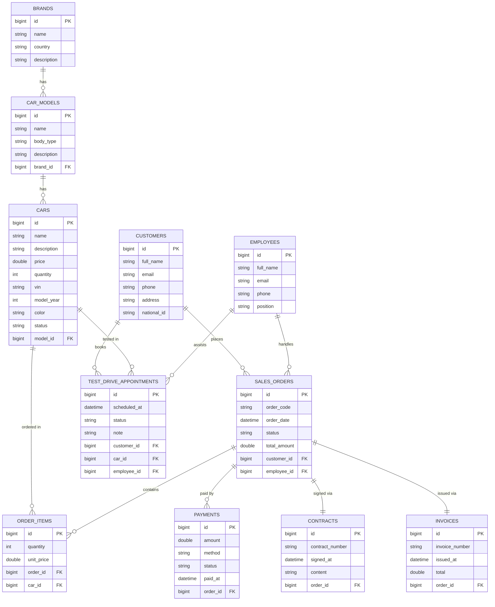
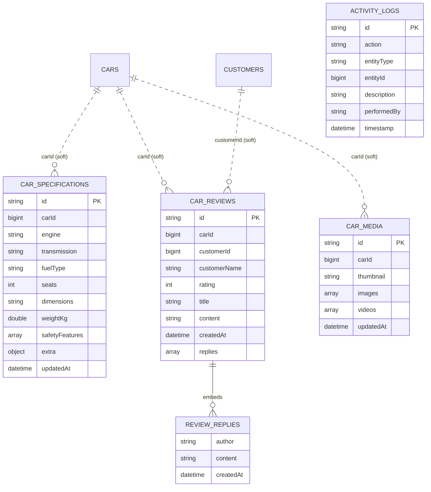

# ERD & Lộ trình chuẩn hóa dự án Car Dealer (full-stack, 5 buổi)

> **Mục đích file này:** giúp một agent/đội khác **tái tạo lại sơ đồ ERD** và
> **chuẩn hóa lại project** theo lộ trình 5 buổi để xây dựng website hoàn chỉnh
> (backend + frontend). Ngày hiện tại: **Buổi 2**.
>
> Công nghệ: Spring Boot 4.1.1 (Java 21) + MySQL (SQL) + MongoDB (NoSQL) + Redis (cache/session)
> + React/Vite (frontend dự kiến). Mã nguồn backend: `src/main/java/com/example/lab5`.

---

## 0. Cách tái tạo ERD (dành cho agent khác)

ERD được định nghĩa **hai lần** bên dưới để tiện tái tạo:

1. **Mermaid `erDiagram`** — render trực tiếp trên GitHub/VS Code hoặc bằng CLI:
   ```bash
   npx -y @mermaid-js/mermaid-cli -i erd.md -o erd.png
   ```
2. **DBML** — dán vào https://dbdiagram.io để sinh diagram + DDL.

Nguồn chân lý (source of truth) để dựng lại ERD là các file:
- SQL entities: `src/main/java/com/example/lab5/entity/*.java`
- NoSQL documents: `src/main/java/com/example/lab5/document/*.java`

Quy ước quan hệ: `||--o{` = 1-nhiều (bắt buộc-1, tùy chọn-nhiều), `||--||` = 1-1.

---

## 1. Sơ đồ ERD (SQL — MySQL/JPA)



### DBML (dbdiagram.io)

```dbml
Table brands {
  id bigint [pk, increment]
  name varchar(100) [not null, unique]
  country varchar(100)
  description varchar(500)
}

Table car_models {
  id bigint [pk, increment]
  name varchar(100) [not null]
  body_type varchar(50)
  description varchar(500)
  brand_id bigint [not null, ref: > brands.id]
}

Table cars {
  id bigint [pk, increment]
  name varchar(100) [not null]
  description varchar(500)
  price double [not null]
  quantity int [not null]
  vin varchar(50) [unique]
  model_year int
  color varchar(50)
  status varchar(20) [not null]
  model_id bigint [not null, ref: > car_models.id]
}

Table customers {
  id bigint [pk, increment]
  full_name varchar(150) [not null]
  email varchar(150) [unique]
  phone varchar(20)
  address varchar(300)
  national_id varchar(30) [unique]
}

Table employees {
  id bigint [pk, increment]
  full_name varchar(150) [not null]
  email varchar(150) [unique]
  phone varchar(20)
  position varchar(100)
}

Table sales_orders {
  id bigint [pk, increment]
  order_code varchar(40) [not null, unique]
  order_date datetime [not null]
  status varchar(20) [not null]
  total_amount double [not null]
  customer_id bigint [not null, ref: > customers.id]
  employee_id bigint [ref: > employees.id]
}

Table order_items {
  id bigint [pk, increment]
  quantity int [not null]
  unit_price double [not null]
  order_id bigint [not null, ref: > sales_orders.id]
  car_id bigint [not null, ref: > cars.id]
}

Table payments {
  id bigint [pk, increment]
  amount double [not null]
  method varchar(30) [not null]
  status varchar(20) [not null]
  paid_at datetime
  order_id bigint [not null, ref: > sales_orders.id]
}

Table contracts {
  id bigint [pk, increment]
  contract_number varchar(40) [not null, unique]
  signed_at datetime
  content varchar(2000)
  order_id bigint [not null, unique, ref: - sales_orders.id]
}

Table invoices {
  id bigint [pk, increment]
  invoice_number varchar(40) [not null, unique]
  issued_at datetime
  total double [not null]
  order_id bigint [not null, unique, ref: - sales_orders.id]
}

Table test_drive_appointments {
  id bigint [pk, increment]
  scheduled_at datetime [not null]
  status varchar(20) [not null]
  note varchar(500)
  customer_id bigint [not null, ref: > customers.id]
  car_id bigint [not null, ref: > cars.id]
  employee_id bigint [ref: > employees.id]
}
```

---

## 2. Chi tiết quan hệ SQL

| Từ | Tới | Kiểu | Cột FK | Xóa (orphan/unique) | Ý nghĩa |
| --- | --- | --- | --- | --- | --- |
| brands | car_models | 1-N | car_models.brand_id (NOT NULL) | — | Hãng có nhiều dòng xe |
| car_models | cars | 1-N | cars.model_id (NOT NULL) | — | Dòng xe có nhiều xe |
| sales_orders | order_items | 1-N | order_items.order_id (NOT NULL) | `cascade = ALL`, `orphanRemoval` | Đơn gồm nhiều dòng xe |
| cars | order_items | 1-N | order_items.car_id (NOT NULL) | — | Một xe xuất hiện trong nhiều đơn |
| customers | sales_orders | 1-N | sales_orders.customer_id (NOT NULL) | — | Khách đặt nhiều đơn |
| employees | sales_orders | 1-N | sales_orders.employee_id (NULL) | — | Nhân viên phụ trách đơn (tùy chọn) |
| sales_orders | payments | 1-N | payments.order_id (NOT NULL) | — | Đơn có nhiều lần thanh toán |
| sales_orders | contracts | 1-1 | contracts.order_id (NOT NULL, UNIQUE) | — | Mỗi đơn tối đa 1 hợp đồng |
| sales_orders | invoices | 1-1 | invoices.order_id (NOT NULL, UNIQUE) | — | Mỗi đơn tối đa 1 hóa đơn |
| customers | test_drive_appointments | 1-N | .customer_id (NOT NULL) | — | Khách đặt nhiều lịch lái thử |
| cars | test_drive_appointments | 1-N | .car_id (NOT NULL) | — | Xe được lái thử |
| employees | test_drive_appointments | 1-N | .employee_id (NULL) | — | Nhân viên hỗ trợ (tùy chọn) |

### Enum (lưu dạng STRING trong CSDL)

| Enum | Giá trị |
| --- | --- |
| `CarStatus` | AVAILABLE, RESERVED, SOLD, MAINTENANCE |
| `OrderStatus` | PENDING, CONFIRMED, COMPLETED, CANCELLED |
| `PaymentMethod` | CASH, BANK_TRANSFER, CARD, INSTALLMENT |
| `PaymentStatus` | UNPAID, PARTIAL, PAID, REFUNDED |
| `AppointmentStatus` | SCHEDULED, CONFIRMED, COMPLETED, CANCELLED |

---

## 3. NoSQL (MongoDB) — collection & quan hệ mềm

Các collection tham chiếu mềm `carId` (và `customerId`) tới SQL, **không có FK cứng**.



| Collection | Index | Ghi chú |
| --- | --- | --- |
| `car_specifications` | `carId` UNIQUE | 1 xe ↔ 1 bộ thông số |
| `car_reviews` | `carId`, text index trên `content` | nhiều đánh giá/xe, có `replies` lồng |
| `activity_logs` | `entityType` | audit log |
| `car_media` | `carId` UNIQUE | album ảnh/video |

Ứng dụng cần `spring.data.mongodb.auto-index-creation=true` để tạo index (prod).

---

## 4. Redis — key & mục đích

| Key pattern | Kiểu | TTL | Mục đích |
| --- | --- | --- | --- |
| `carDetail::{id}` | string/JSON | 10 phút | Cache chi tiết xe (`CarCatalogService`) |
| `carSearch::{name}` | JSON | 10 phút | Cache kết quả tìm kiếm nóng |
| `cart:{sessionId}` | hash (carId→quantity) | 30 phút | Giỏ cấu hình xe (`ConfiguratorCartService`) |
| `session:{token}` | string (userId) | 30 phút | Token phiên đăng nhập (`SessionService`) |

---

## 5. Máy trạng thái & nghiệp vụ chính

**Trạng thái đơn hàng (`OrderStatus`)**
```
PENDING -> CONFIRMED -> COMPLETED
   |            |
   +--> CANCELLED <--+
```

**Luồng tồn kho (`CarStatus`)**: AVAILABLE → RESERVED → SOLD; MAINTENANCE khi bảo trì.
- `SalesOrderServiceImpl.create`: trong `@Transactional`, kiểm tra tồn kho, trừ `quantity`,
  đặt `SOLD` khi `quantity == 0`.
- `SalesOrderServiceImpl.cancel`: hoàn tồn kho, đưa xe `SOLD` về `AVAILABLE`.
- `PaymentServiceImpl.create`: khi `PaymentStatus = PAID` → cập nhật đơn `COMPLETED`.

---

## 6. API hiện có (backend)

Xem chi tiết tại Swagger UI `/swagger-ui.html` và `README.md`. Nhóm endpoint chính:

| Nhóm | Base path |
| --- | --- |
| Hãng xe | `/api/brands` |
| Dòng xe | `/api/car-models` |
| Xe + tìm kiếm | `/api/cars` |
| Khách hàng | `/api/customers` |
| Nhân viên | `/api/employees` |
| Đơn hàng | `/api/orders` |
| Thanh toán | `/api/payments` |
| Hợp đồng | `/api/contracts` |
| Hóa đơn | `/api/invoices` |
| Lịch lái thử | `/api/test-drives` |
| Thông số kỹ thuật (Mongo) | `/api/car-specs` |
| Đánh giá (Mongo) | `/api/car-reviews` |
| Log hoạt động (Mongo) | `/api/activity-logs` |
| Media (Mongo) | `/api/car-media` |
| Giỏ cấu hình (Redis) | `/api/cart` |
| Session (Redis) | `/api/sessions` |
| Báo cáo (SQL thuần) | `/api/reports/*` |

---

## 7. Cấu trúc thư mục chuẩn hóa (monorepo backend + frontend)

Mục tiêu: tách rõ **backend** và **frontend**, gom tài liệu vào `docs/`.
Project hiện tại đang ở dạng backend-only tại gốc `demo/`.

```
demo/
├── backend/                      # Spring Boot (di chuyển project hiện tại vào đây)
│   ├── pom.xml
│   ├── src/main/java/com/example/lab5/
│   │   ├── config/               # CacheConfig, DataSeeder, (SecurityConfig - buổi 5)
│   │   ├── controller/
│   │   ├── dto/
│   │   ├── entity/               # SQL/JPA
│   │   ├── document/             # NoSQL/MongoDB
│   │   ├── mapper/
│   │   ├── repository/           # SQL + JdbcTemplate
│   │   ├── mongorepository/      # NoSQL
│   │   ├── service/ + Impl/
│   │   └── exception/
│   └── src/main/resources/       # application*.properties
│
├── frontend/                    # React + Vite + TypeScript (dựng ở buổi 3)
│   ├── package.json
│   ├── vite.config.ts           # proxy /api -> http://localhost:8080
│   └── src/
│       ├── api/                 # lớp gọi REST (axios/fetch)
│       ├── components/
│       ├── pages/
│       ├── routes/
│       └── store/               # state (giỏ cấu hình, session)
│
├── docs/                        # (tùy chọn) gom tài liệu; hiện tại để ở gốc
│   ├── openapi.yaml             # export từ /v3/api-docs (buổi 5)
│   └── ...
│
├── erd.md                       # file này (có thể chuyển vào docs/)
├── plan.md
├── report.md
│
└── docker-compose.yml           # MySQL + MongoDB + Redis (buổi 5)
```

> **Lưu ý cho agent:** việc di chuyển backend vào `backend/` là thay đổi lớn
> (đổi đường dẫn Maven). Nếu thực hiện, phải chạy lại `.\mvnw.cmd test` để đảm bảo
> 21 test vẫn xanh. Có thể giữ nguyên vị trí hiện tại và chỉ tạo `frontend/` cạnh nó
> ở giai đoạn đầu để giảm rủi ro.

---

## 8. Lộ trình 5 buổi (hôm nay: Buổi 2)

### Buổi 1 — Phân tích, thiết kế CSDL & backend SQL lõi  [HOÀN THÀNH]
- Khảo sát mã mẫu (`code mẫu bên main/`, `code mẫu bên test/`), chốt kiến trúc đa tầng.
- Thiết kế ERD SQL (Brand/CarModel/Car + nghiệp vụ Customer/Employee/Order/Payment/Contract/Invoice/TestDrive).
- Dựng `entity`, `dto` (record), `mapper`, `repository` (JPA + derived/JPQL + `JdbcTemplate`), `service/Impl`, `controller`.
- Cấu hình MySQL prod + H2 test (`application-test.properties`), `GlobalExceptionHandler`.
- **Deliverable:** CRUD + tìm kiếm xe chạy được.

### Buổi 2 — Hoàn thiện backend đa tầng: NoSQL + Redis + Báo cáo + Kiểm thử  [HÔM NAY — HOÀN THÀNH]
- MongoDB: `CarSpecification`, `CarReview`, `ActivityLog`, `CarMedia` + repository + service + controller.
- Redis: cache (`@Cacheable` chi tiết/tìm kiếm xe), giỏ cấu hình (`/api/cart`), session/token (`/api/sessions`).
- Báo cáo SQL thuần (JdbcTemplate): top xe bán chạy, tồn kho theo hãng, doanh thu, đơn theo trạng thái.
- Kiểm thử: repository search, service tồn kho, controller MockMvc, NoSQL service (mock) — **21 test PASS**.
- Tài liệu: Swagger/OpenAPI (springdoc v3), seed dữ liệu (`DataSeeder`), `README.md`.
- **Deliverable:** backend REST hoàn chỉnh, tài liệu hóa, test xanh. (Còn nợ: phân quyền — dời sang buổi 5.)

### Buổi 3 — Khởi tạo Frontend & tính năng công khai
- Khởi tạo `frontend/` (React + Vite + TypeScript), cấu hình proxy `/api` và CORS backend.
- Lớp `api/` gọi REST; layout, routing, trang chủ.
- Trang **danh sách xe** (phân trang), **chi tiết xe** (ảnh từ `car-media`, thông số từ `car-specs`,
  đánh giá từ `car-reviews`), **tìm kiếm/lọc nâng cao** (theo tên/giá/tồn kho/hãng/dòng).
- **Deliverable:** website xem/sản phẩm xe hoạt động, dữ liệu lấy từ backend.

### Buổi 4 — Frontend nghiệp vụ & tài khoản
- Giỏ cấu hình (gọi `/api/cart`, lưu theo `sessionId`); đặt hàng (`/api/orders`).
- Thanh toán (`/api/payments`), lịch lái thử (`/api/test-drives`), gửi đánh giá (`/api/car-reviews`).
- Đăng nhập/đăng xuất với session Redis (`/api/sessions`).
- Trang **quản trị** CRUD: brands, car-models, cars, customers, employees, orders.
- **Deliverable:** luồng mua xe end-to-end + trang admin.

### Buổi 5 — Bảo mật, triển khai & hoàn thiện
- Phân quyền: Spring Security + JWT (admin / nhân viên bán hàng / khách), bảo vệ endpoint admin.
- Upload media xe, dashboard báo cáo (chart từ `/api/reports/*`).
- `docker-compose.yml` (MySQL + MongoDB + Redis), seed, biến môi trường.
- Kiểm thử end-to-end, tối ưu cache, xuất `openapi.yaml`, hoàn thiện tài liệu.
- **Deliverable:** website full-stack chạy được end-to-end, có phân quyền, đóng gói triển khai.

---

## 9. Trạng thái hiện tại (đối chiếu nhanh)

| Hạng mục | Trạng thái |
| --- | --- |
| Backend SQL (11 entity + nghiệp vụ) | Xong |
| Backend NoSQL (4 document) | Xong |
| Redis (cache/cart/session) | Xong |
| Báo cáo SQL thuần | Xong |
| Kiểm thử (`.\mvnw.cmd test`) | 21/21 PASS |
| Swagger/OpenAPI, seed, README | Xong |
| Phân quyền | Chưa (dời buổi 5) |
| Frontend | Chưa (buổi 3-4) |
| Docker/deploy | Chưa (buổi 5) |

---

## 10. Gợi ý prompt cho agent triển khai buổi 3

> Đọc `erd.md`. Khởi tạo `frontend/` với React + Vite + TypeScript, cấu hình proxy
> `/api` tới `http://localhost:8080`. Xây dựng trang danh sách xe và chi tiết xe gọi các
> endpoint `/api/cars`, `/api/cars/{id}`, `/api/cars/search/*`, `/api/car-media/{carId}`,
> `/api/car-specs/{carId}`, `/api/car-reviews/car/{carId}` và
> `/api/car-reviews/car/{carId}/summary`. Giữ đúng hợp đồng dữ liệu (record DTO)
> mô tả trong `erd.md` và Swagger `/v3/api-docs`.
