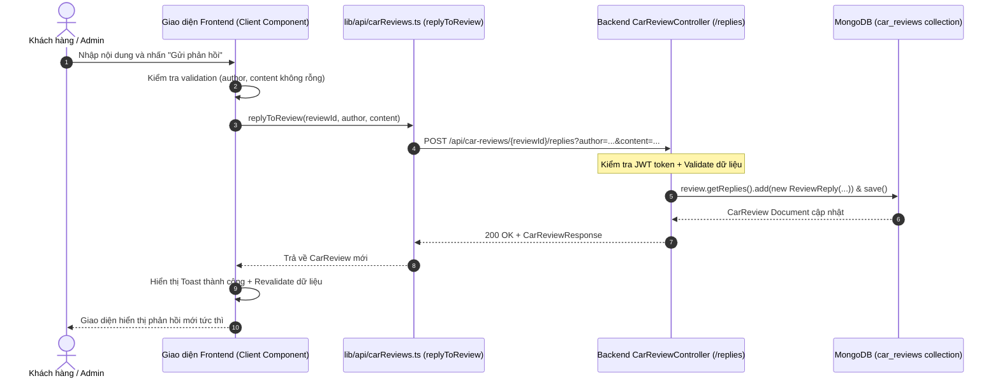

# Task 7 — Triển khai tính năng Phản hồi Đánh giá (Review Reply) trên Frontend

> **Mục tiêu:** Backend đã cung cấp đầy đủ API cho phép phản hồi một đánh giá xe (`POST /api/car-reviews/{reviewId}/replies`), DTO và hàm API client `replyToReview` ở frontend đã được định nghĩa sẵn nhưng **giao diện người dùng (cả trang chi tiết xe lẫn trang quản trị Admin) chưa hề triển khai tính năng này**.
> Task này lên kế hoạch chi tiết để hiện thực hóa tính năng phản hồi đánh giá trên toàn bộ Frontend:
> 1. **Trang chi tiết xe (`/cars/[id]`):** Hiển thị danh sách phản hồi chuyên nghiệp (thời gian, tác giả, badge đại lý) và form trả lời trực tiếp cho người dùng đã đăng nhập.
> 2. **Trang quản trị đánh giá (`/admin/reviews`):** Bổ sung cột đếm phản hồi và modal cho phép Admin/Nhân viên xem chi tiết chuỗi trao đổi và gửi phản hồi chính thức từ đại lý.
>
> **Nguyên tắc làm việc:**
> - Giữ nguyên contract API backend đang hoạt động ổn định (`POST /api/car-reviews/{reviewId}/replies?author=...&content=...`).
> - Đảm bảo phân quyền an toàn: yêu cầu đăng nhập khi gửi phản hồi, tự động nhận diện danh xưng tác giả (khách hàng hoặc đại lý).
> - Giữ vững tiêu chuẩn chất lượng: `npx tsc --noEmit` sạch 0 lỗi, `npm run build` xanh, giao diện chuẩn Design System Car Dealer (gam màu `#0a0a0a` & vàng hoàng gia `#c58e00`/`#f59e0b`).
>
> **Trạng thái: LÊN KẾ HOẠCH (PLANNING)**

---

## 1. Hiện trạng & Khoảng trống tính năng (Gap Analysis)

### 1.1. Hiện trạng Backend (Đã hoàn thiện 100%)

Backend đã hỗ trợ đầy đủ việc lưu trữ và xử lý phản hồi đánh giá:

| Thành phần | Vị trí file | Trạng thái hiện tại |
|---|---|---|
| **MongoDB Document** | `com.example.lab5.document.CarReview` | Trường `replies: List<ReviewReply>` (`author`, `content`, `createdAt`). |
| **DTO Response** | `com.example.lab5.dto.CarReviewResponse` | Record `Reply(String author, String content, LocalDateTime createdAt)`. |
| **Mapper** | `com.example.lab5.mapper.CarReviewMapper` | Đã ánh xạ mảng `replies` từ entity sang DTO response. |
| **Controller API** | `com.example.lab5.controller.CarReviewController` | `POST /api/car-reviews/{reviewId}/replies?author={author}&content={content}` trả về `CarReviewResponse`. |
| **Service Logic** | `com.example.lab5.service.Impl.CarReviewServiceImpl` | `addReply(reviewId, author, content)` kiểm tra validation rỗng và lưu vào MongoDB. |
| **Phân quyền** | `com.example.lab5.config.SecurityConfig` | Dòng 112: `POST /api/car-reviews/*/replies` yêu cầu `.authenticated()`. |

### 1.2. Hiện trạng Frontend (Chưa hoàn thiện UI/UX)

| Thành phần | Vị trí file | Hiện trạng | Khoảng trống cần khắc phục |
|---|---|---|---|
| **Type Definition** | `frontend/src/types/carReview.ts` | Đã có `interface Reply` & `CarReview.replies: Reply[]` | Đầy đủ, sẵn sàng sử dụng. |
| **API Client** | `frontend/src/lib/api/carReviews.ts` | Đã có hàm `replyToReview(reviewId, author, content)` | Đã export nhưng **chưa nơi nào gọi**. |
| **Trang chi tiết xe** | `frontend/src/app/cars/[id]/page.tsx` | Đã render `review.replies` sơ sài | - Chỉ hiện text `Trả lời: content`<br>- Thiếu tên người phản hồi (`author`) và ngày giờ (`createdAt`)<br>- **Không có nút hay form nào để người xem trả lời**. |
| **Trang Admin Reviews** | `frontend/src/app/admin/reviews/page.tsx` | Dùng generic `ResourceManager<CarReview>` | - Không hiển thị số lượng phản hồi<br>- Không có nút xem danh sách phản hồi<br>- **Không có chỗ để Admin/Nhân viên trả lời khách hàng**. |

---

## 2. Mục tiêu & Yêu cầu tính năng (Requirements)

### 2.1. Phía Khách hàng / Public (`/cars/[id]`)
1. **Nâng cấp giao diện hiển thị danh sách phản hồi (Threaded Comments):**
   - Lùi lề rõ ràng dưới từng đánh giá để phân biệt cấp bậc (nested view).
   - Hiển thị tên người trả lời (`author`), thời gian gửi tương đối/tuyệt đối (`formatDateTime`).
   - Nếu phản hồi đến từ Admin/Nhân viên (hoặc chứa từ khóa đại lý): hiển thị huy hiệu (Badge) nổi bật `Đại lý Car Dealer`.
2. **Form gửi phản hồi (Interactive Reply):**
   - Dưới mỗi đánh giá có nút **"Trả lời"** kèm biểu tượng trò chuyện.
   - Khi bấm "Trả lời":
     - Nếu chưa đăng nhập: nhắc nhở hoặc chuyển hướng sang trang đăng nhập (`/login?next=/cars/{carId}`).
     - Nếu đã đăng nhập: mở khung nhập phản hồi inline bên dưới đánh giá đó.
   - Tự động điền tên tác giả từ tài khoản đang đăng nhập (`user.username`).
   - Có nút **"Hủy"** và nút **"Gửi phản hồi"** (với trạng thái loading chống click đúp).
   - Sau khi gửi thành công: thông báo Toast, đóng form và cập nhật danh sách hiển thị ngay lập tức (qua `router.refresh()`).

### 2.2. Phía Quản trị viên / Nhân viên (`/admin/reviews`)
1. **Bảng thống kê phản hồi:**
   - Thêm cột **"Phản hồi"** trên bảng đánh giá:
     - Nếu đã có phản hồi: hiển thị badge số lượng (ví dụ: `2 phản hồi` màu xanh/vàng nhạt).
     - Nếu chưa có: hiển thị nhãn xám `Chưa có`.
2. **Nút thao tác "Phản hồi":**
   - Tận dụng thuộc tính `rowActions` của `ResourceManager` để thêm nút **"Phản hồi"** bên cạnh nút "Sửa" và "Xóa".
3. **Modal quản trị phản hồi (`ReviewReplyModal`):**
   - **Phần 1 - Đánh giá gốc:** Thông tin khách hàng, xe, số sao, tiêu đề, nội dung và ngày đánh giá.
   - **Phần 2 - Lịch sử trao đổi:** Liệt kê toàn bộ phản hồi đã có theo thứ tự thời gian.
   - **Phần 3 - Khung trả lời của đại lý:**
     - Cho phép chọn danh xưng người trả lời: `Ban Quản Trị Car Dealer` (mặc định) hoặc tên nhân viên đăng nhập.
     - Textarea nhập nội dung phản hồi chính thức từ đại lý.
     - Nút "Gửi phản hồi": gọi API `replyToReview`, cập nhật danh sách phản hồi trong modal và nạp lại bảng admin.

---

## 3. Thiết kế kỹ thuật chi tiết (Technical Design)

### 3.1. Sơ đồ luồng tương tác (Sequence Flow)



### 3.2. Cấu trúc Component mới & Cải tiến

```
frontend/src/
├── app/
│   ├── admin/reviews/
│   │   └── page.tsx                     # [Cập nhật] Thêm cột replies + rowActions nút Phản hồi
│   └── cars/[id]/
│       └── page.tsx                     # [Cập nhật] Tích hợp ReviewItem Component
├── components/
│   ├── admin/
│   │   └── ReviewReplyModal.tsx         # [Tạo mới] Modal xem & gửi phản hồi phía Admin
│   └── car/
│       ├── ReviewItem.tsx               # [Tạo mới] Client component hiển thị review, replies & inline reply form
│       └── ReviewForm.tsx               # [Giữ nguyên] Form viết đánh giá mới
└── lib/api/
    └── carReviews.ts                    # [Giữ nguyên] replyToReview đã sẵn sàng
```

---

## 4. Kế hoạch triển khai từng bước (Step-by-step Implementation Plan)

### Bước 1: Xây dựng Modal phản hồi phía Admin (`ReviewReplyModal.tsx`)
- **Vị trí file:** `frontend/src/components/admin/ReviewReplyModal.tsx`
- **Nhiệm vụ:**
  - Nhận props: `review: CarReview | null`, `open: boolean`, `onClose: () => void`, `onSuccess: () => void`.
  - Quản lý form gửi phản hồi: `author` (mặc định lấy `Ban Quản Trị Car Dealer` hoặc username từ `useAuth()`), `content`.
  - Hiển thị danh sách replies hiện tại với thẻ tác giả, ngày tháng, nội dung.
  - Xử lý gọi `replyToReview(review.id, author, content)`.
  - Hiển thị toast thông báo và gọi `onSuccess()` để đóng modal và refresh lại bảng.

### Bước 2: Tích hợp vào Trang Quản trị Đánh giá (`AdminReviewsPage`)
- **Vị trí file:** `frontend/src/app/admin/reviews/page.tsx`
- **Nhiệm vụ:**
  - Thêm cột `replies` vào bảng `columns`:
    ```tsx
    {
      key: 'replies',
      label: 'Phản hồi',
      className: 'text-center',
      render: (r) => (
        r.replies?.length ? (
          <span className="inline-flex items-center px-2 py-0.5 rounded-full text-xs font-medium bg-amber-50 text-amber-800 border border-amber-200">
            {r.replies.length} phản hồi
          </span>
        ) : (
          <span className="text-xs text-[#9ca3af]">Chưa có</span>
        )
      ),
    }
    ```
  - Quản lý state `replyingReview: CarReview | null` và `replyModalOpen: boolean`.
  - Sử dụng prop `rowActions` của `ResourceManager`:
    ```tsx
    rowActions={(row) => (
      <Button size="sm" variant="outline" onClick={() => openReplyModal(row)}>
        Phản hồi {row.replies?.length ? `(${row.replies.length})` : ''}
      </Button>
    )}
    ```
  - Render `ReviewReplyModal` kèm theo logic nạp lại dữ liệu bảng sau khi reply.

### Bước 3: Xây dựng Component `ReviewItem.tsx` cho Trang Chi tiết Xe
- **Vị trí file:** `frontend/src/components/car/ReviewItem.tsx`
- **Nhiệm vụ:**
  - Chuyển logic hiển thị từng review thành Client Component (`'use client'`).
  - Hiển thị thông tin đánh giá: Avatar chữ cái đầu, tên khách hàng, số sao, ngày gửi, tiêu đề, nội dung.
  - Render danh sách phản hồi lồng (`review.replies`):
    - Avatar/Icon phản hồi.
    - Tên tác giả + Badge `Đại lý Car Dealer` nếu tác giả là admin/nhân viên hoặc chứa chữ "Đại lý".
    - Ngày gửi định dạng tiếng Việt.
    - Nội dung phản hồi.
  - Nút **"Trả lời"**:
    - Khi click: kiểm tra `isAuthenticated`. Nếu chưa, gợi ý đăng nhập.
    - Mở form inline: textarea nhập nội dung + nút "Gửi" và "Hủy".
    - Gọi API `replyToReview`.
    - Gọi `router.refresh()` và cập nhật danh sách local để phản hồi xuất hiện tức thì.

### Bước 4: Cập nhật Trang Chi Tiết Xe (`/cars/[id]/page.tsx`)
- **Vị trí file:** `frontend/src/app/cars/[id]/page.tsx`
- **Nhiệm vụ:**
  - Thay thế khối hiển thị danh sách `carReviews.map(...)` cũ bằng component `ReviewItem`.
  - Giữ nguyên cấu trúc Server Component của `page.tsx` để tối ưu SEO và tốc độ tải trang ban đầu.

---

## 5. Kế hoạch kiểm thử & Tiêu chí nghiệm thu (Test Plan & Acceptance Criteria)

### 5.1. Bảng Ma trận Kiểm thử (Test Matrix)

| STT | Kịch bản kiểm thử | Thao tác thực hiện | Kết quả mong đợi |
|:---:|---|---|---|
| **TC1** | Xem phản hồi trên trang chi tiết xe | Truy cập `/cars/{id}` có đánh giá đã có reply | Danh sách phản hồi hiển thị thụt lề rõ ràng, hiện đủ tên tác giả, ngày giờ và badge nếu là đại lý. |
| **TC2** | Khách chưa đăng nhập bấm "Trả lời" | Đăng xuất, vào `/cars/{id}`, bấm "Trả lời" ở một đánh giá | Toast thông báo yêu cầu đăng nhập hoặc chuyển hướng đến `/login?next=/cars/{id}`. |
| **TC3** | Khách đã đăng nhập gửi phản hồi | Đăng nhập tài khoản user, nhập nội dung phản hồi, bấm "Gửi" | Gọi API thành công, Toast báo "Đã gửi phản hồi", phản hồi mới hiển thị ngay lập tức. |
| **TC4** | Kiểm tra validation rỗng | Bấm "Gửi" khi chưa nhập nội dung | Form báo lỗi yêu cầu nhập nội dung, không gửi request lên backend. |
| **TC5** | Admin xem số lượng phản hồi | Đăng nhập ADMIN/EMPLOYEE, vào `/admin/reviews` | Bảng hiển thị cột "Phản hồi" với số lượng chính xác (`X phản hồi` hoặc `Chưa có`). |
| **TC6** | Admin mở modal và trả lời đánh giá | Bấm nút "Phản hồi" ở 1 dòng review, nhập nội dung, bấm "Gửi" | Modal hiển thị lịch sử trao đổi, gửi thành công, badge số lượng trên bảng tăng lên tương ứng. |
| **TC7** | Xử lý lỗi mạng / token hết hạn | Token hết hạn khi gửi phản hồi | Toast thông báo lỗi phiên đăng nhập rõ ràng, không crash ứng dụng. |

### 5.2. Tiêu chí nghiệm thu kỹ thuật
1. **Kiểm tra kiểu dữ liệu:** Chạy `npx tsc --noEmit` trong thư mục `frontend` không phát sinh bất kỳ lỗi TypeScript nào.
2. **Kiểm tra Build:** Chạy `npm run build` trong `frontend` hoàn thành thành công với trạng thái xanh.
3. **Tính tương thích:** Không làm ảnh hưởng đến các chức năng CRUD đánh giá hiện có (Thêm, Sửa, Xóa đánh giá của admin và gửi đánh giá mới của khách).
4. **Trải nghiệm người dùng (UX):** Không gây hiện tượng giật/nhấp nháy trang (FOUC), có trạng thái loading rõ ràng khi gửi request.
